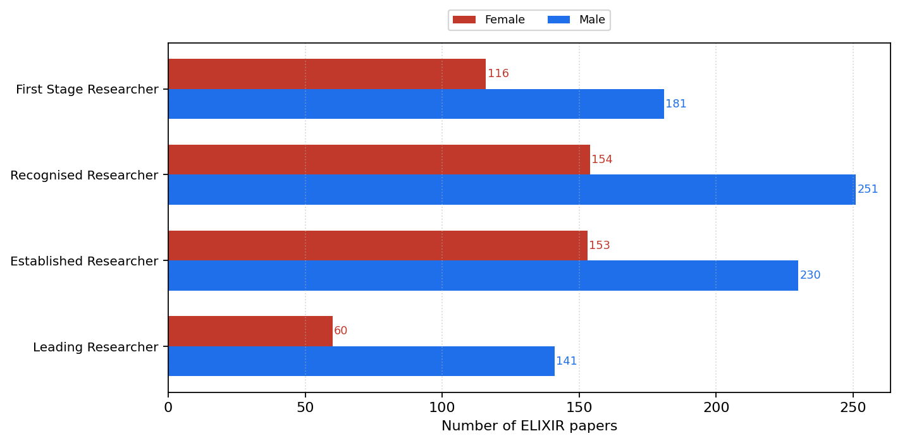
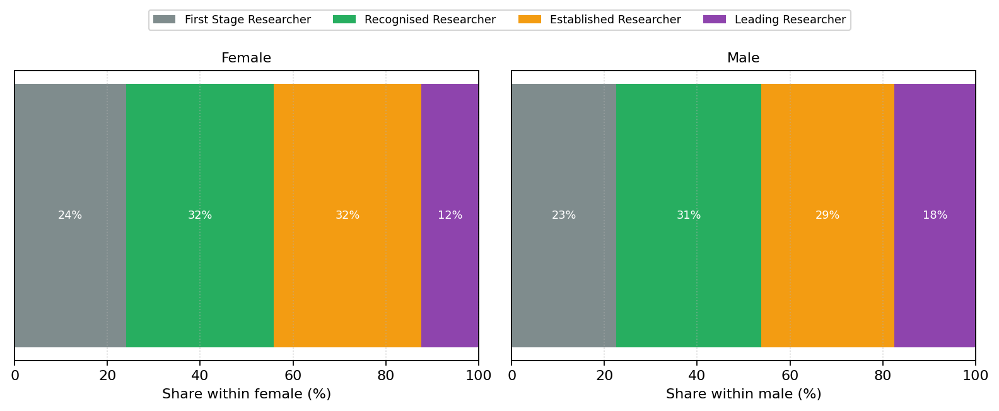
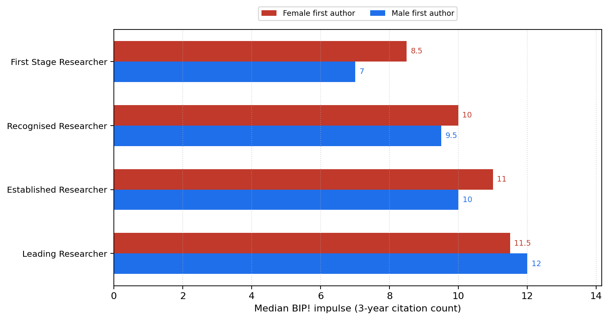
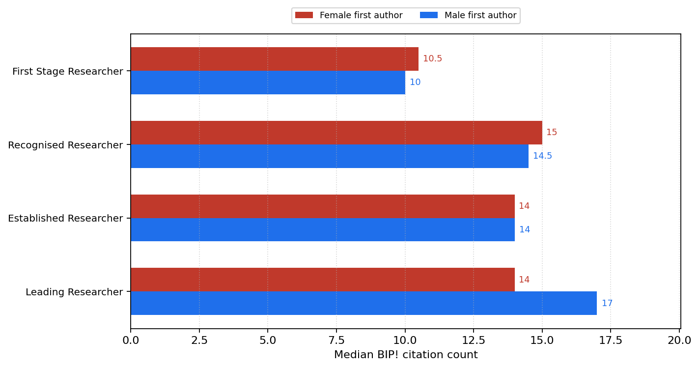
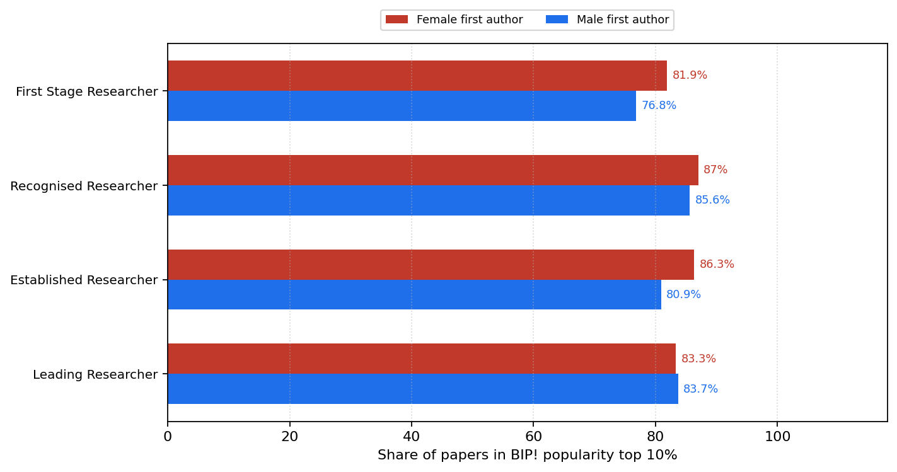
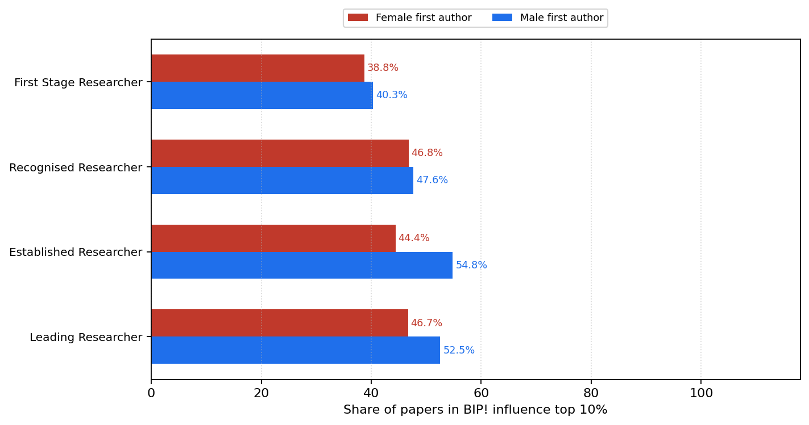
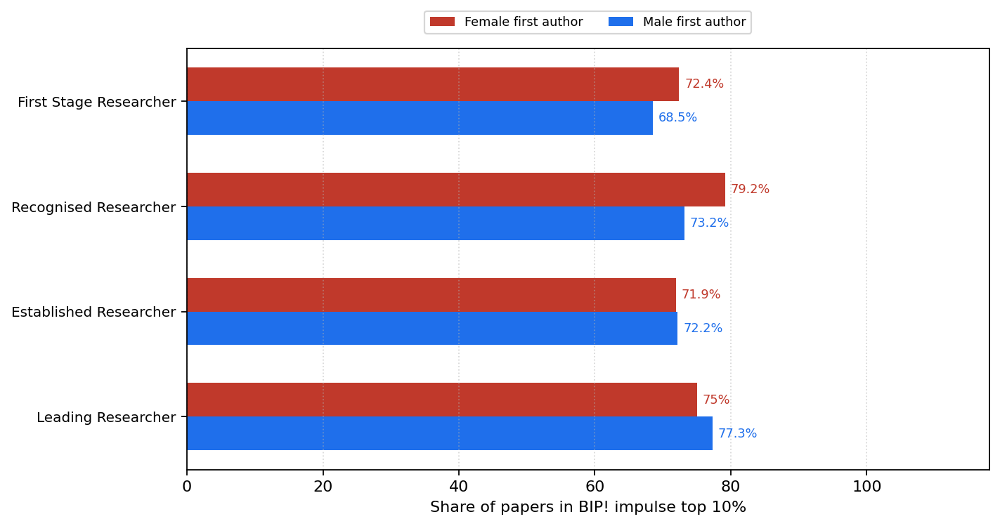
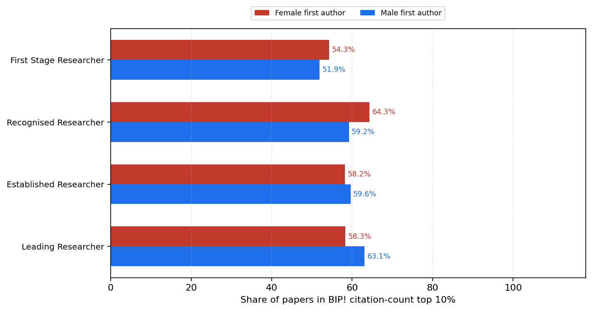

# ELIXIR BIP! by first-author academic age and gender

## Process

First-author gender (from `data/elixir_unique_authors_dedup_countries_gender.tsv`) was joined to academic age from `data/elixir_authors_academic_age.csv` (`scripts/attach_author_academic_age.py --role first`). Academic age at paper = publication year − OpenAlex first publication year. Stages: **R1** 0–4y, **R2** 5–10y, **R3** 11–20y, **R4** ≥21y (ages missing/negative → unknown; >60 → implausible). Across the full ELIXIR corpus we count papers by first-author stage × gender and recompute BIP! statistics for female and male subsets within each R stage (not stratified by topic).

### Join coverage (all papers)

- Papers: **1331**
- Male / female / unknown gender: **823** / **495** / **13**
- Researcher stages: `{'R1': 298, 'R2': 408, 'R3': 384, 'R4': 203, 'implausible': 15, 'unknown': 23}`
- Age-at-paper matched: **1308**

### Counts by stage × gender

| Stage | Female | Male | Total |
|---|---:|---:|---:|
| First Stage Researcher | 116 | 181 | 297 |
| Recognised Researcher | 154 | 251 | 405 |
| Established Researcher | 153 | 230 | 383 |
| Leading Researcher | 60 | 141 | 201 |

## Count and composition figures

Paper counts by first-author R stage with female vs male side-by-side, and within-gender percentage shares of R1–R4. Unknown / implausible ages and unknown gender are excluded from these plots.

### Paper counts by first-author stage × gender

### Share of R stages within each first-author gender

## BIP! indicator figures

Grouped bars compare female vs male first-author subsets within each R stage. The **bar length / x-axis** is the BIP! statistic. Unknown gender and unknown/implausible ages are excluded.

### Median BIP! impulse (3-year citation count)

### Median BIP! citation count

### Share of papers in BIP! popularity top 10%

### Share of papers in BIP! influence top 10%

### Share of papers in BIP! impulse top 10%

### Share of papers in BIP! citation-count top 10%

## Stage × gender BIP! stats

| Stage | Gender | n | median impulse | median cc | pct pop top10 | pct inf top10 | pct imp top10 | pct cc top10 |
|---|---|---:|---:|---:|---:|---:|---:|---:|
| R1 | female | 116 | 8.5 | 10.5 | 81.9 | 38.8 | 72.4 | 54.3 |
| R1 | male | 181 | 7 | 10 | 76.8 | 40.3 | 68.5 | 51.9 |
| R2 | female | 154 | 10 | 15 | 87.0 | 46.8 | 79.2 | 64.3 |
| R2 | male | 251 | 9.5 | 14.5 | 85.6 | 47.6 | 73.2 | 59.2 |
| R3 | female | 153 | 11 | 14 | 86.3 | 44.4 | 71.9 | 58.2 |
| R3 | male | 230 | 10 | 14 | 80.9 | 54.8 | 72.2 | 59.6 |
| R4 | female | 60 | 11.5 | 14 | 83.3 | 46.7 | 75.0 | 58.3 |
| R4 | male | 141 | 12 | 17 | 83.7 | 52.5 | 77.3 | 63.1 |

_Generated 2026-11-12 19:57 UTC_
