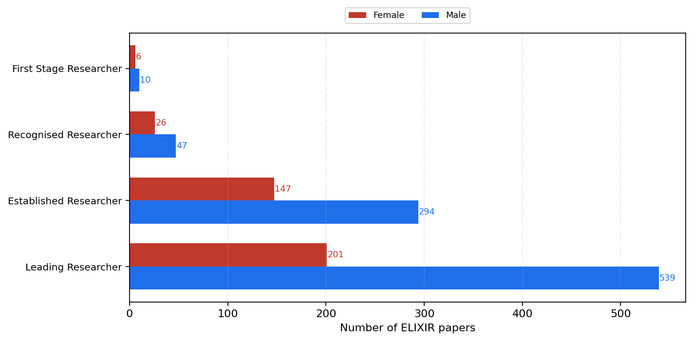
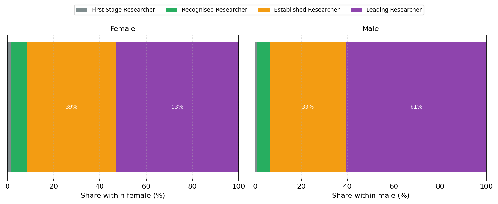
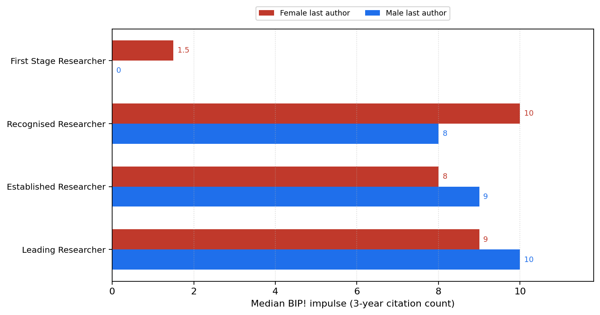
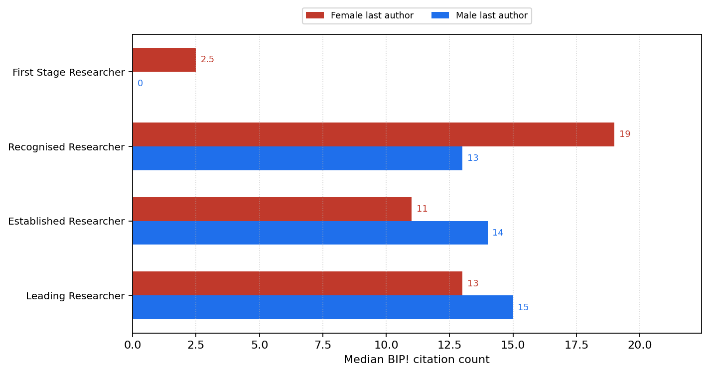
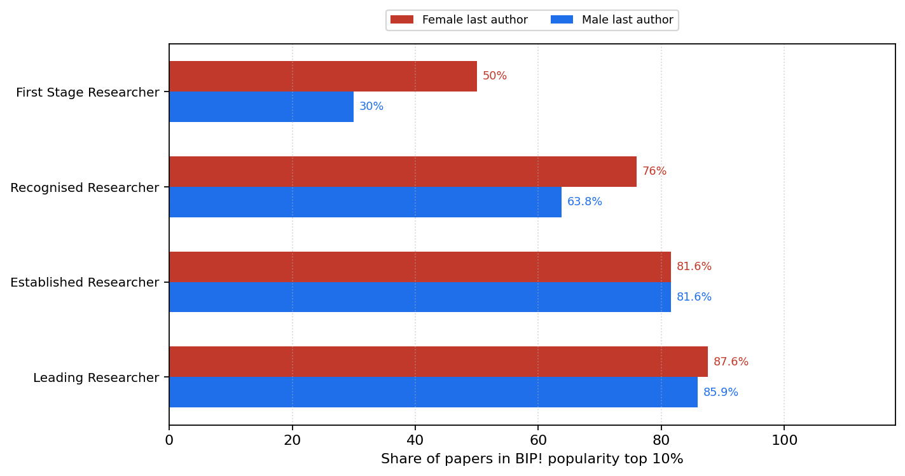
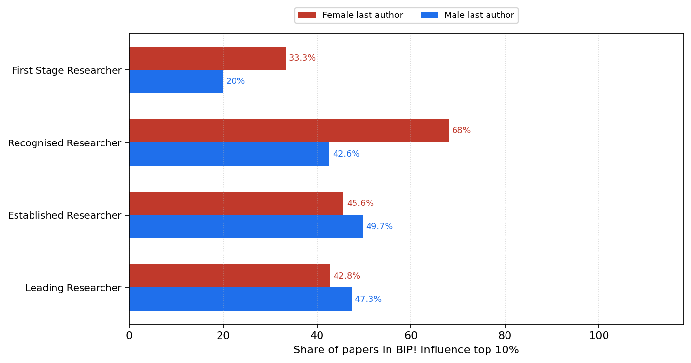
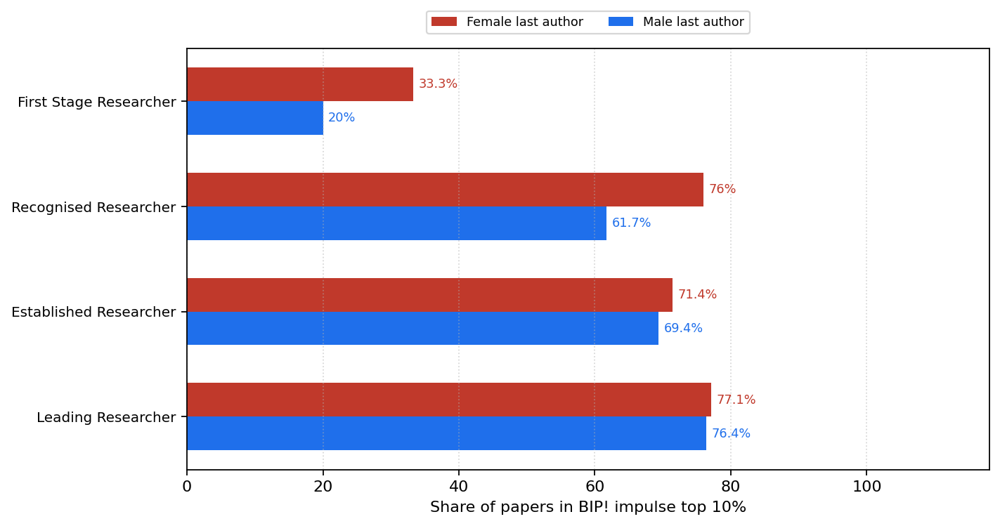
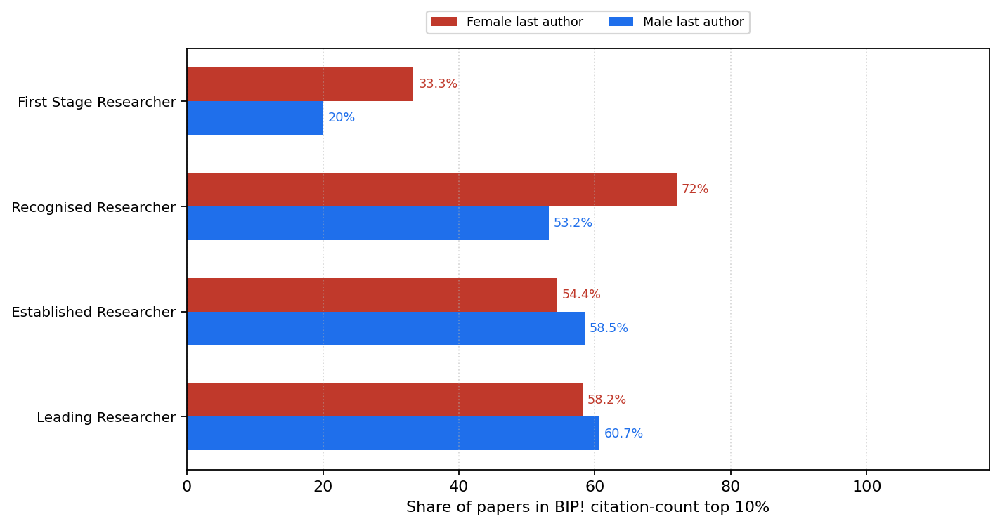

# ELIXIR BIP! by last-author academic age and gender

## Process

Last-author gender (from `data/elixir_unique_authors_dedup_countries_gender.tsv`) was joined to academic age from `data/elixir_authors_academic_age.csv` (`scripts/attach_author_academic_age.py --role last`). Academic age at paper = publication year − OpenAlex first publication year. Stages: **R1** 0–4y, **R2** 5–10y, **R3** 11–20y, **R4** ≥21y (ages missing/negative → unknown; >60 → implausible). Across the full ELIXIR corpus we count papers by last-author stage × gender and recompute BIP! statistics for female and male subsets within each R stage (not stratified by topic).

### Join coverage (all papers)

- Papers: **1331**
- Male / female / unknown gender: **929** / **383** / **19**
- Researcher stages: `{'R1': 16, 'R2': 76, 'R3': 442, 'R4': 740, 'implausible': 31, 'unknown': 26}`
- Age-at-paper matched: **1305**

### Counts by stage × gender

| Stage | Female | Male | Total |
|---|---:|---:|---:|
| First Stage Researcher | 6 | 10 | 16 |
| Recognised Researcher | 26 | 47 | 73 |
| Established Researcher | 147 | 294 | 441 |
| Leading Researcher | 201 | 539 | 740 |

## Count and composition figures

Paper counts by last-author R stage with female vs male side-by-side, and within-gender percentage shares of R1–R4. Unknown / implausible ages and unknown gender are excluded from these plots.

### Paper counts by last-author stage × gender

### Share of R stages within each last-author gender

## BIP! indicator figures

Grouped bars compare female vs male last-author subsets within each R stage. The **bar length / x-axis** is the BIP! statistic. Unknown gender and unknown/implausible ages are excluded.

### Median BIP! impulse (3-year citation count)

### Median BIP! citation count

### Share of papers in BIP! popularity top 10%

### Share of papers in BIP! influence top 10%

### Share of papers in BIP! impulse top 10%

### Share of papers in BIP! citation-count top 10%

## Stage × gender BIP! stats

| Stage | Gender | n | median impulse | median cc | pct pop top10 | pct inf top10 | pct imp top10 | pct cc top10 |
|---|---|---:|---:|---:|---:|---:|---:|---:|
| R1 | female | 6 | 1.5 | 2.5 | 50.0 | 33.3 | 33.3 | 33.3 |
| R1 | male | 10 | 0 | 0 | 30.0 | 20.0 | 20.0 | 20.0 |
| R2 | female | 26 | 10 | 19 | 76.0 | 68.0 | 76.0 | 72.0 |
| R2 | male | 47 | 8 | 13 | 63.8 | 42.6 | 61.7 | 53.2 |
| R3 | female | 147 | 8 | 11 | 81.6 | 45.6 | 71.4 | 54.4 |
| R3 | male | 294 | 9 | 14 | 81.6 | 49.7 | 69.4 | 58.5 |
| R4 | female | 201 | 9 | 13 | 87.6 | 42.8 | 77.1 | 58.2 |
| R4 | male | 539 | 10 | 15 | 85.9 | 47.3 | 76.4 | 60.7 |

_Generated 2026-11-12 19:57 UTC_
