# Elixir vs OpenAlex topic BIP! comparison

## Process

Starting from `data/elixir_works_metadata_openalex_bip.csv`, we counted how often each OpenAlex **primary topic** appears among ELIXIR papers and ranked topics by that frequency (`results/openalex_topic_counts.csv`). We then kept the **top 5** topics and, for each, summarised BIP! impact on the ELIXIR papers in that topic (medians of impulse and citation count; share of papers in the BIP! top 10% for popularity, influence, impulse, and citations—see `results/openalex_topic_stats.csv`). To ask whether those ELIXIR values are unusual for the topic, we built a reference from the wider OpenAlex graph: for a topic with n ELIXIR papers we drew **500** random OpenAlex samples of size n, matching ELIXIR’s publication-year mix, restricted to the same primary topic, requiring a DOI, excluding ELIXIR DOIs, and scoring each paper with BIP!. The same statistics were recomputed on every sample. Across the 500 draws we report the mean and the central 95% range (2.5th–97.5th percentiles) and place the ELIXIR value in that range (including whether it falls outside). Plots are in [`topic_comparison_figures/`](../figures/topic_comparison_figures/). Raw popularity/influence score plots are omitted; we keep the top-10% class shares instead. Seed `42`. OpenAlex n is the topic’s `works_count` from the OpenAlex topics API (all works with that primary topic). Sample papers include OpenAlex author lists in `topic_comparison_samples/samples.csv` (`authors`) and `samples_authors.csv` (one row per author, with best-effort `first_name`/`last_name` when the name string can be split).

### Topics

| Topic | ELIXIR n | OpenAlex n | OpenAlex topic id |
|---|---:|---:|---|
| Research Data Management Practices | 154 | 265,910 | `T11937` |
| Genomics and Phylogenetic Studies | 113 | 260,355 | `T10015` |
| Scientific Computing and Data Management | 95 | 62,318 | `T11986` |
| Bioinformatics and Genomic Networks | 73 | 61,821 | `T10887` |
| Protein Structure and Dynamics | 69 | 220,661 | `T10044` |

## Forest plots

One panel per BIP! statistic. Each row is a topic. The grey bar is the central 95% range of that statistic across the 500 year-matched OpenAlex samples; the open grey circle is the mean of those samples; the red point is the ELIXIR value for the topic. Use these to see, at a glance, whether ELIXIR sits inside or outside the OpenAlex reference band for every topic.

### Median BIP! impulse (3-year citation count)

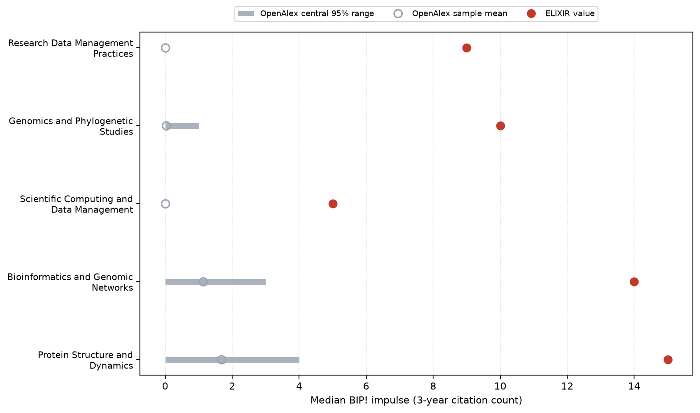

### Median BIP! citation count

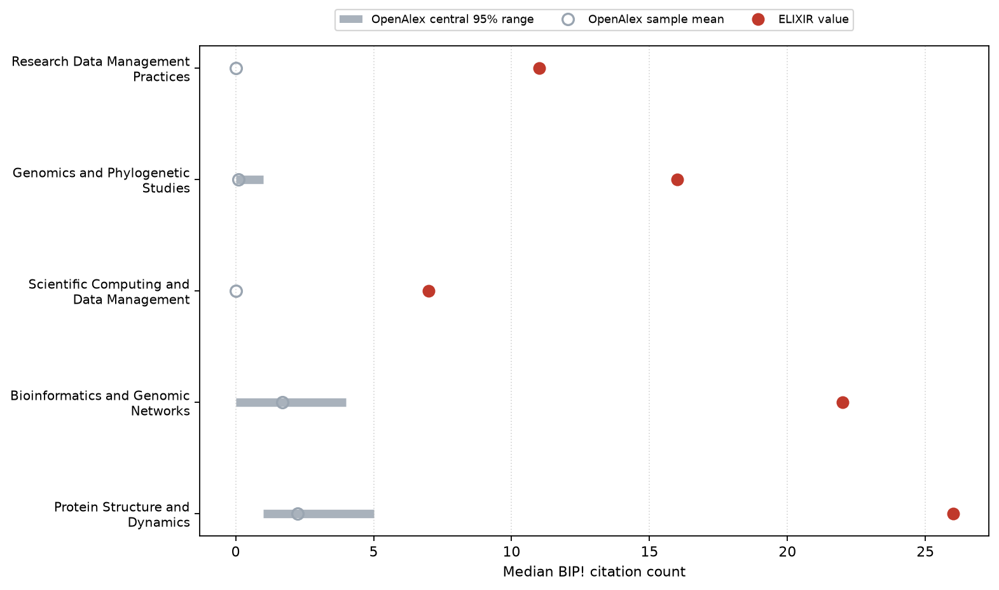

### Share of papers in BIP! popularity top 10%

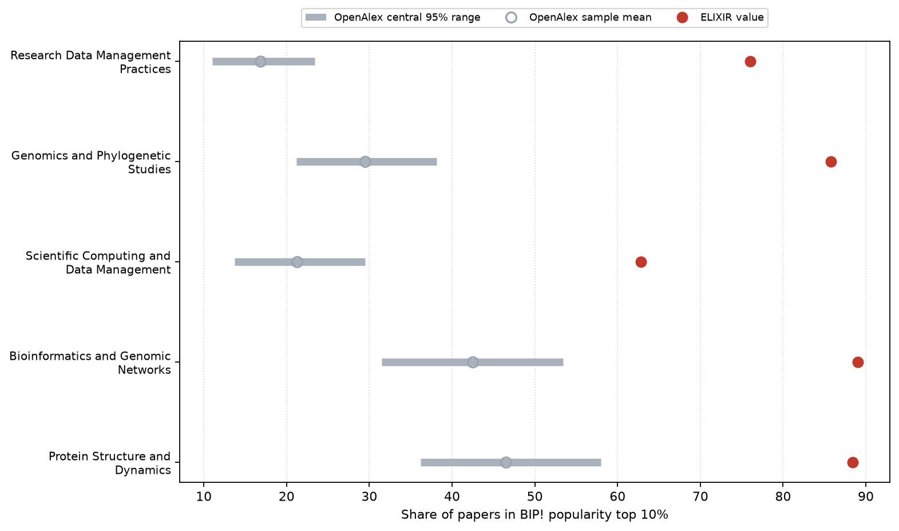

### Share of papers in BIP! influence top 10%

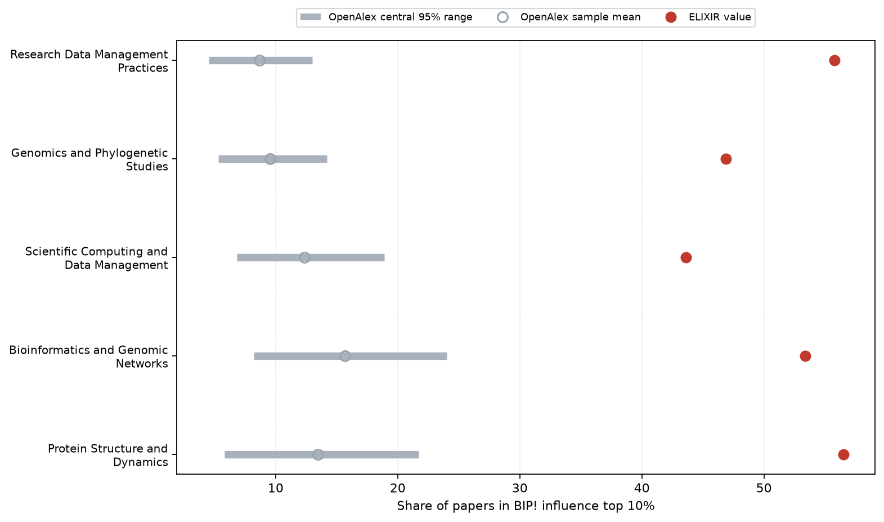

### Share of papers in BIP! impulse top 10%

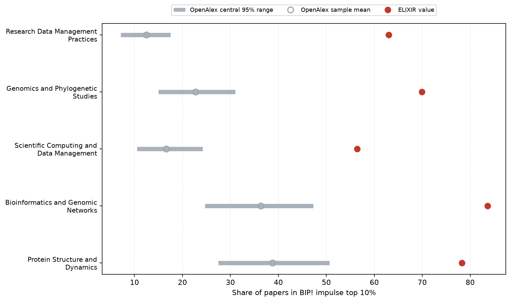

### Share of papers in BIP! citation-count top 10%

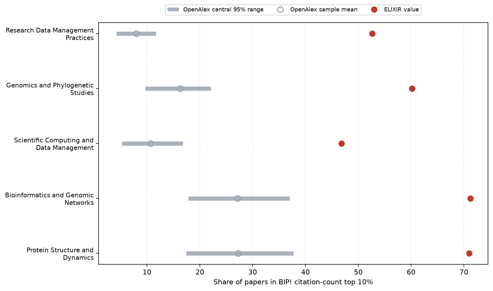

## Null histograms

One figure per BIP! statistic, with a small histogram for each topic. Bars show the distribution of the 500 OpenAlex-sample values; the red vertical line is the ELIXIR value. Use these to see the shape of the OpenAlex null and how far ELIXIR lies from that cloud.

### Median BIP! impulse (3-year citation count)

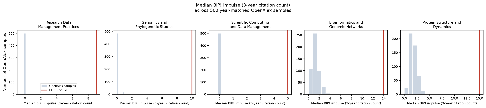

### Median BIP! citation count

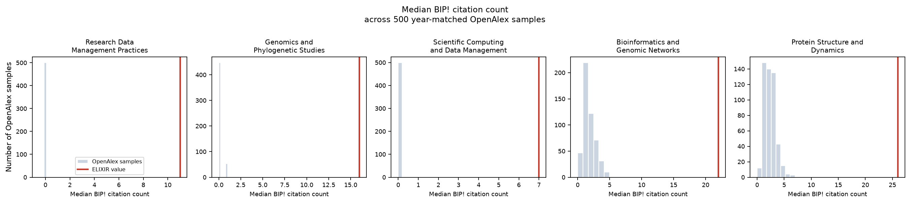

### Share of papers in BIP! popularity top 10%

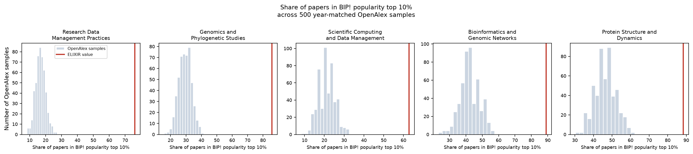

### Share of papers in BIP! influence top 10%

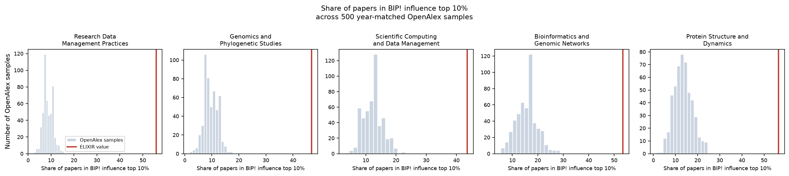

### Share of papers in BIP! impulse top 10%

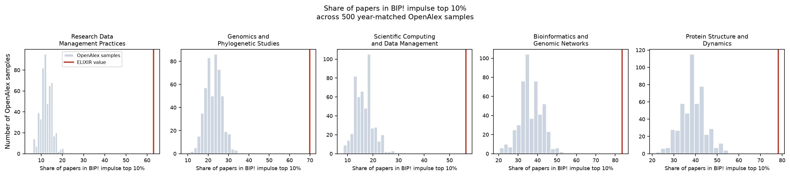

### Share of papers in BIP! citation-count top 10%

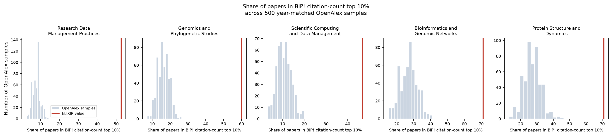

## Main findings

**40** topic×statistic pairs fall **outside** the 95% OpenAlex reference band (of 40 comparisons).

| Topic | Statistic | Elixir | OpenAlex mean | 95% band | Direction | p |
|---|---|---:|---:|---|---|---:|
| Research Data Management Practices | `median_popularity` | 9.009341E-9 | 1.767949E-9 | [1.683513E-9, 1.944044E-9] | higher | 0.0 |
| Research Data Management Practices | `median_influence` | 2.907353E-9 | 2.174628E-9 | [2.174628E-9, 2.174628E-9] | higher | 0.0 |
| Research Data Management Practices | `median_impulse` | 9 | 0 | [0, 0] | higher | 0.0 |
| Research Data Management Practices | `median_cc` | 11 | 0 | [0, 0] | higher | 0.0 |
| Research Data Management Practices | `pct_pop_top10` | 76 | 16.8308 | [11, 23.4] | higher | 0.0 |
| Research Data Management Practices | `pct_inf_top10` | 55.8 | 8.6504 | [4.5, 13] | higher | 0.0 |
| Research Data Management Practices | `pct_imp_top10` | 63 | 12.4576 | [7.1, 17.5] | higher | 0.0 |
| Research Data Management Practices | `pct_cc_top10` | 52.6 | 7.9228 | [4.185, 11.7] | higher | 0.0 |
| Genomics and Phylogenetic Studies | `median_popularity` | 1.022127E-8 | 1.988745E-9 | [1.910188E-9, 2.249780E-9] | higher | 0.0 |
| Genomics and Phylogenetic Studies | `median_influence` | 2.600728E-9 | 2.175989E-9 | [2.174628E-9, 2.189815E-9] | higher | 0.0 |
| Genomics and Phylogenetic Studies | `median_impulse` | 10 | 0.032 | [0, 1] | higher | 0.0 |
| Genomics and Phylogenetic Studies | `median_cc` | 16 | 0.106 | [0, 1] | higher | 0.0 |
| Genomics and Phylogenetic Studies | `pct_pop_top10` | 85.8 | 29.4746 | [21.2, 38.1] | higher | 0.0 |
| Genomics and Phylogenetic Studies | `pct_inf_top10` | 46.9 | 9.5246 | [5.3, 14.2] | higher | 0.0 |
| Genomics and Phylogenetic Studies | `pct_imp_top10` | 69.9 | 22.7282 | [15, 31] | higher | 0.0 |
| Genomics and Phylogenetic Studies | `pct_cc_top10` | 60.2 | 16.2446 | [9.7, 22.1] | higher | 0.0 |
| Scientific Computing and Data Management | `median_popularity` | 6.552419E-9 | 1.972361E-9 | [1.777872E-9, 2.249780E-9] | higher | 0.0 |
| Scientific Computing and Data Management | `median_influence` | 2.530405E-9 | 2.174645E-9 | [2.174628E-9, 2.174628E-9] | higher | 0.0 |
| Scientific Computing and Data Management | `median_impulse` | 5 | 0 | [0, 0] | higher | 0.0 |
| Scientific Computing and Data Management | `median_cc` | 7 | 0.002 | [0, 0] | higher | 0.0 |
| Scientific Computing and Data Management | `pct_pop_top10` | 62.8 | 21.2444 | [13.7, 29.5] | higher | 0.0 |
| Scientific Computing and Data Management | `pct_inf_top10` | 43.6 | 12.3354 | [6.8225, 18.9] | higher | 0.0 |
| Scientific Computing and Data Management | `pct_imp_top10` | 56.4 | 16.6104 | [10.5, 24.2] | higher | 0.0 |
| Scientific Computing and Data Management | `pct_cc_top10` | 46.8 | 10.7074 | [5.3, 16.8] | higher | 0.0 |
| Bioinformatics and Genomic Networks | `median_popularity` | 1.415299E-8 | 2.350828E-9 | [1.683513E-9, 3.687111E-9] | higher | 0.0 |
| Bioinformatics and Genomic Networks | `median_influence` | 2.754036E-9 | 2.218839E-9 | [2.174628E-9, 2.291580E-9] | higher | 0.0 |
| Bioinformatics and Genomic Networks | `median_impulse` | 14 | 1.138 | [0, 3] | higher | 0.0 |
| Bioinformatics and Genomic Networks | `median_cc` | 22 | 1.7 | [0, 4] | higher | 0.0 |
| Bioinformatics and Genomic Networks | `pct_pop_top10` | 89 | 42.513 | [31.5, 53.4] | higher | 0.0 |
| Bioinformatics and Genomic Networks | `pct_inf_top10` | 53.4 | 15.673 | [8.2, 24.035] | higher | 0.0 |
| Bioinformatics and Genomic Networks | `pct_imp_top10` | 83.6 | 36.386 | [24.7, 47.2825] | higher | 0.0 |
| Bioinformatics and Genomic Networks | `pct_cc_top10` | 71.2 | 27.15 | [17.8, 37] | higher | 0.0 |
| Protein Structure and Dynamics | `median_popularity` | 1.436090E-8 | 2.817186E-9 | [2.100531E-9, 4.244212E-9] | higher | 0.0 |
| Protein Structure and Dynamics | `median_influence` | 2.808135E-9 | 2.222809E-9 | [2.179542E-9, 2.287027E-9] | higher | 0.0 |
| Protein Structure and Dynamics | `median_impulse` | 15 | 1.676 | [0, 4] | higher | 0.0 |
| Protein Structure and Dynamics | `median_cc` | 26 | 2.25 | [1, 5] | higher | 0.0 |
| Protein Structure and Dynamics | `pct_pop_top10` | 88.4 | 46.4742 | [36.2, 58] | higher | 0.0 |
| Protein Structure and Dynamics | `pct_inf_top10` | 56.5 | 13.4466 | [5.8, 21.7] | higher | 0.0 |
| Protein Structure and Dynamics | `pct_imp_top10` | 78.3 | 38.8022 | [27.5, 50.7] | higher | 0.0 |
| Protein Structure and Dynamics | `pct_cc_top10` | 71 | 27.285 | [17.4, 37.7] | higher | 0.0 |

_Generated 2026-11-12 16:33 UTC_
