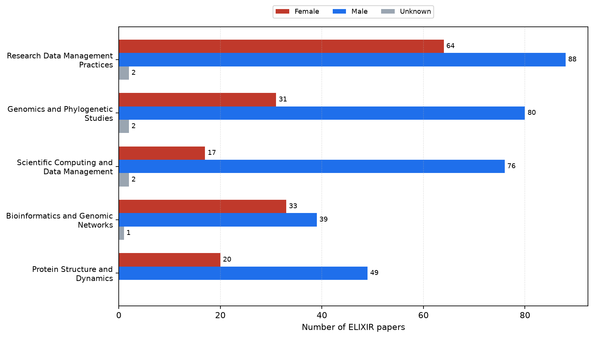
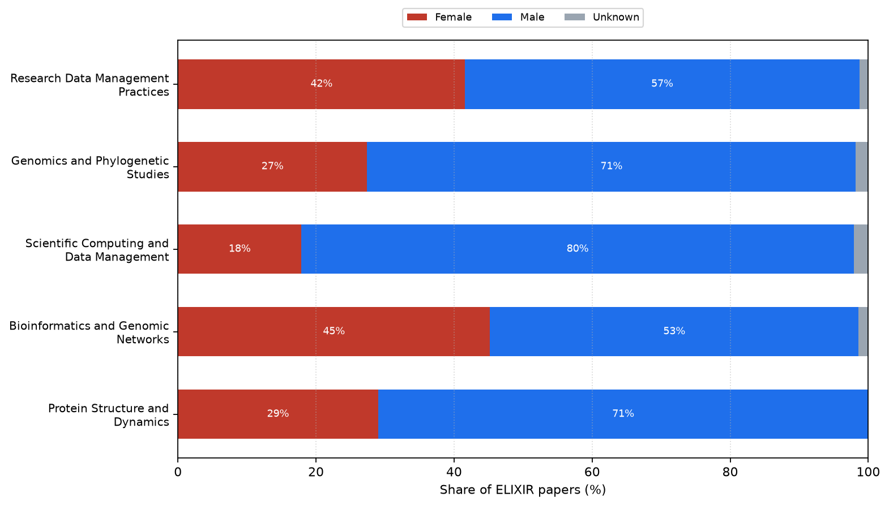
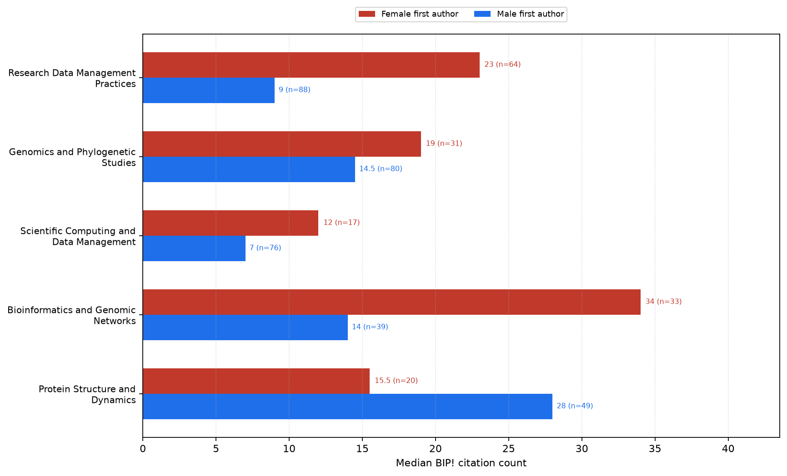
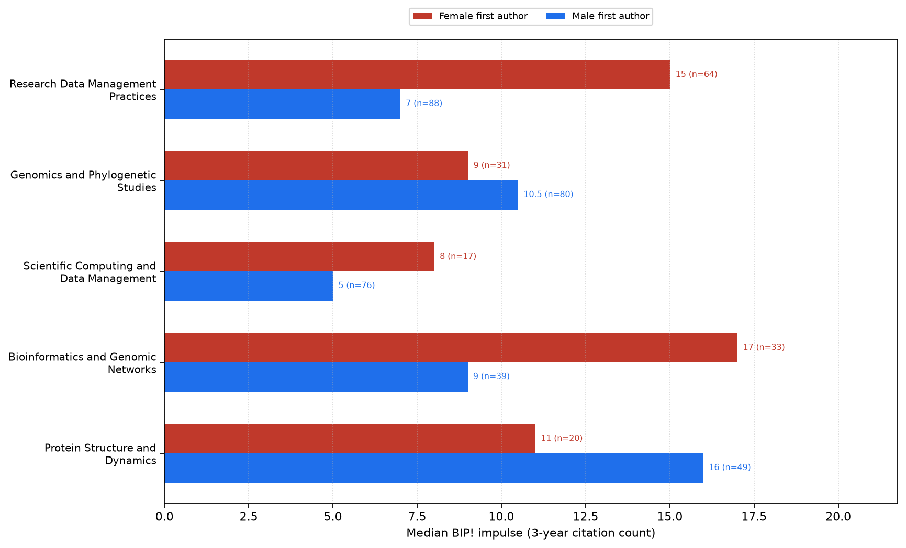
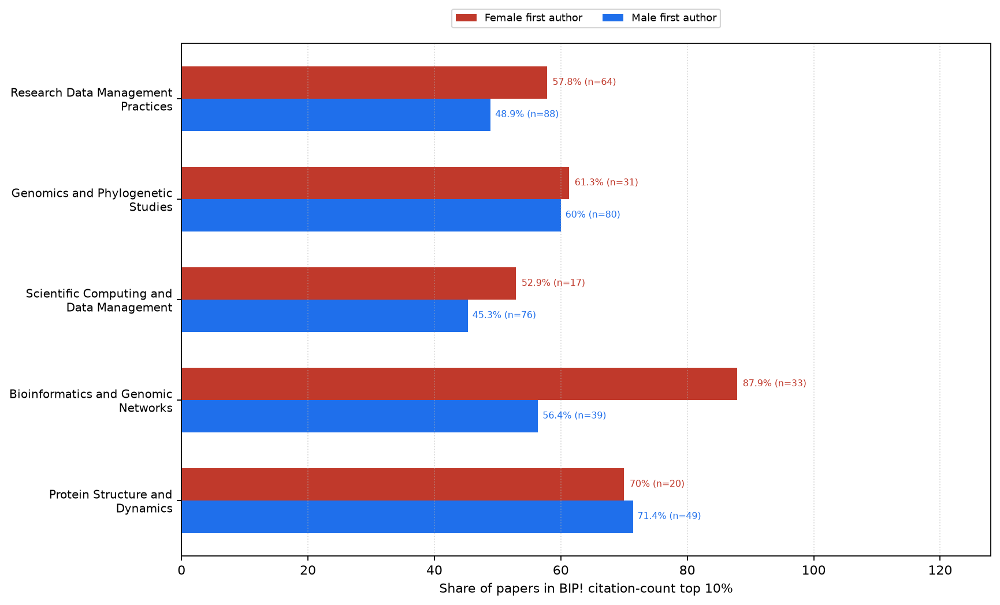
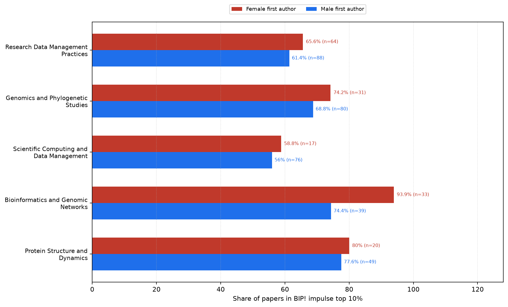
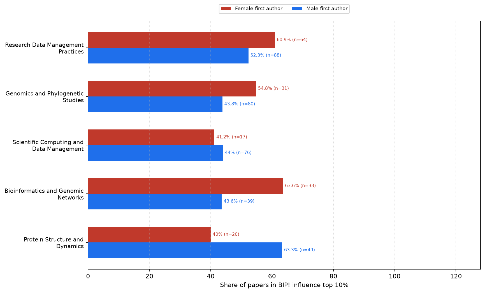
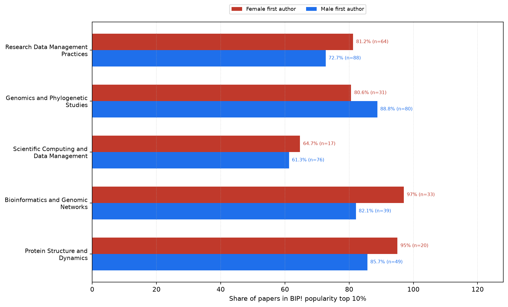

# ELIXIR topic BIP! by first-author gender

## Process

First-author gender was attached from `data/elixir_unique_authors_dedup_countries_gender.tsv` to `data/elixir_works_metadata_openalex_bip.csv` (`scripts/attach_first_author_gender.py`). Within each of the top 5 OpenAlex primary topics, we count papers by inferred first-author gender and recompute the same BIP! statistics as `count_topics.py` for female and male subsets.

### Join coverage (all papers)

- Papers: **1331**
- Male / female / unknown: **823** / **495** / **13**
- Match methods: `{'exact_full': 1271, 'norm_full': 51, 'unmatched': 4, 'exact_fl': 1, 'norm_full_strip_middle': 2, 'no_author': 2}`

### Topics

| Topic | ELIXIR n | Female | Male | Unknown |
|---|---:|---:|---:|---:|
| Research Data Management Practices | 154 | 64 | 88 | 2 |
| Genomics and Phylogenetic Studies | 113 | 31 | 80 | 2 |
| Scientific Computing and Data Management | 95 | 17 | 76 | 2 |
| Bioinformatics and Genomic Networks | 73 | 33 | 39 | 1 |
| Protein Structure and Dynamics | 69 | 20 | 49 | 0 |

## Count and composition figures

Paper counts and percentage shares by first-author gender within each topic (unknown includes unmatched consortia and non-retrievable names).

### Paper counts by first-author gender

### Share of papers by first-author gender

## BIP! indicator figures

Grouped bars compare female vs male first-author subsets within each topic. The **bar length / x-axis** is the BIP! statistic. The label next to each bar shows that same value plus **n = number of papers** in that gender×topic subset (sample size used to compute the statistic — not an x-axis quantity). Unknown-gender papers are excluded from these plots.

### Median BIP! citation count

### Median BIP! impulse (3-year citation count)

### Share of papers in BIP! citation-count top 10%

### Share of papers in BIP! impulse top 10%

### Share of papers in BIP! influence top 10%

### Share of papers in BIP! popularity top 10%

## Per-topic gender BIP! stats

| Topic | Gender | n | median impulse | median cc | pct pop top10 | pct inf top10 | pct imp top10 | pct cc top10 |
|---|---|---:|---:|---:|---:|---:|---:|---:|
| Research Data Management Practices | female | 64 | 15 | 23 | 81.2 | 60.9 | 65.6 | 57.8 |
| Research Data Management Practices | male | 88 | 7 | 9 | 72.7 | 52.3 | 61.4 | 48.9 |
| Genomics and Phylogenetic Studies | female | 31 | 9 | 19 | 80.6 | 54.8 | 74.2 | 61.3 |
| Genomics and Phylogenetic Studies | male | 80 | 10.5 | 14.5 | 88.8 | 43.8 | 68.8 | 60.0 |
| Scientific Computing and Data Management | female | 17 | 8 | 12 | 64.7 | 41.2 | 58.8 | 52.9 |
| Scientific Computing and Data Management | male | 76 | 5 | 7 | 61.3 | 44.0 | 56.0 | 45.3 |
| Bioinformatics and Genomic Networks | female | 33 | 17 | 34 | 97.0 | 63.6 | 93.9 | 87.9 |
| Bioinformatics and Genomic Networks | male | 39 | 9 | 14 | 82.1 | 43.6 | 74.4 | 56.4 |
| Protein Structure and Dynamics | female | 20 | 11 | 15.5 | 95.0 | 40.0 | 80.0 | 70.0 |
| Protein Structure and Dynamics | male | 49 | 16 | 28 | 85.7 | 63.3 | 77.6 | 71.4 |

_Generated 2026-11-12 13:33 UTC_
