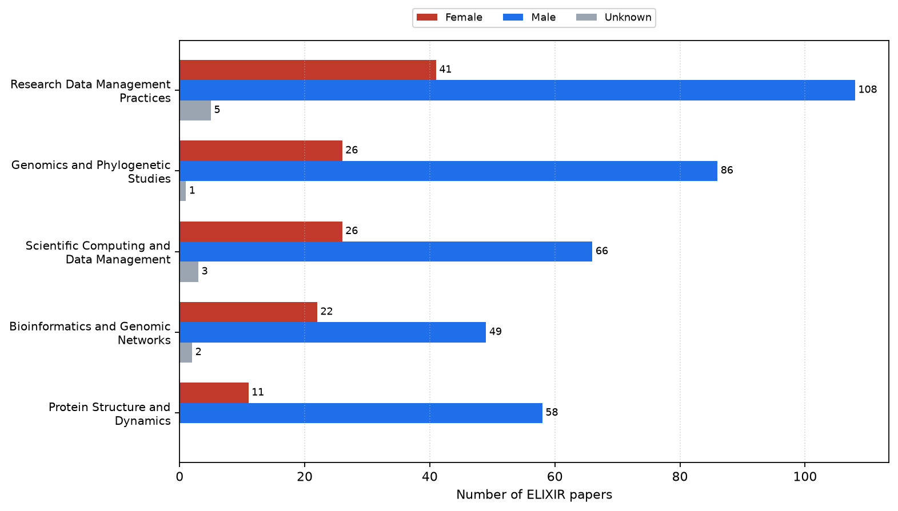
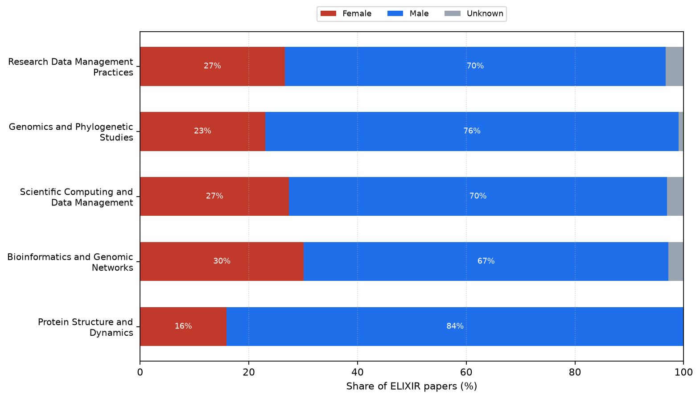
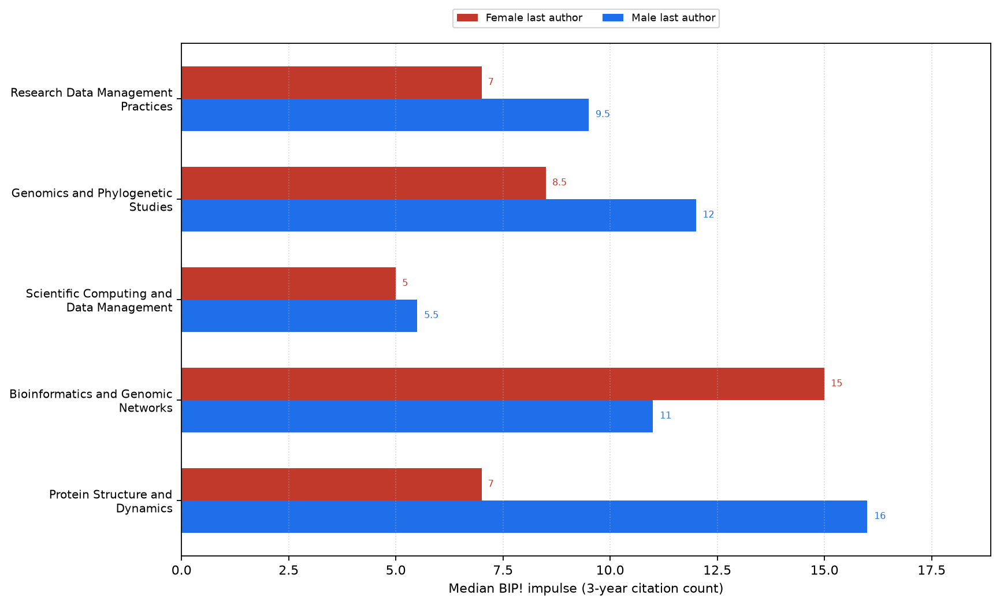
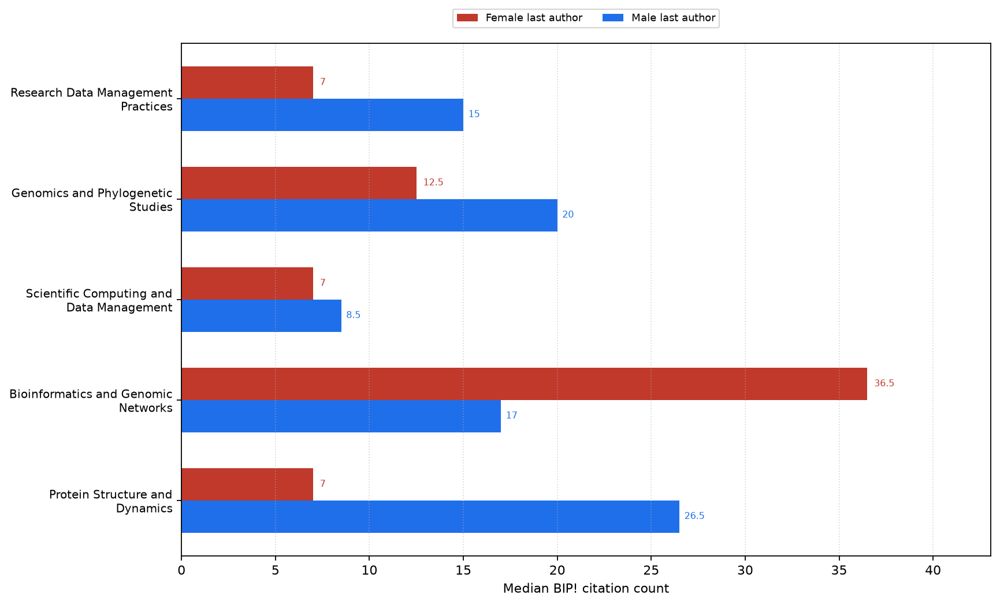
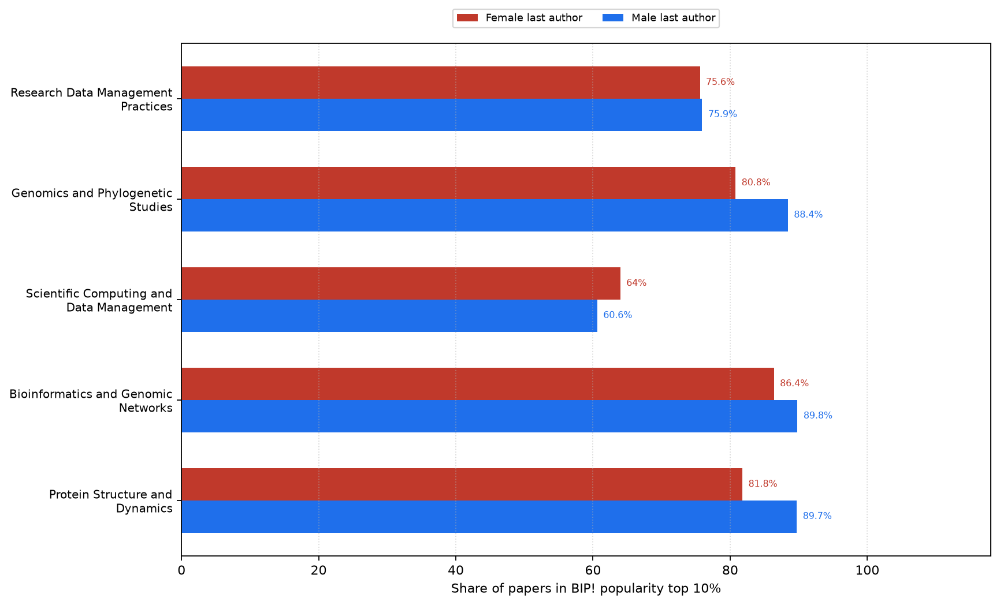
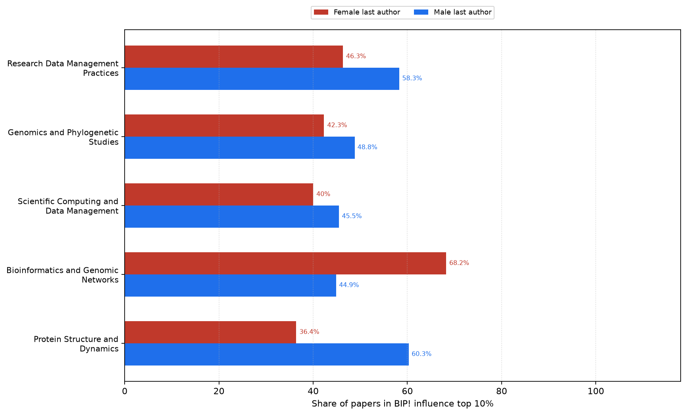
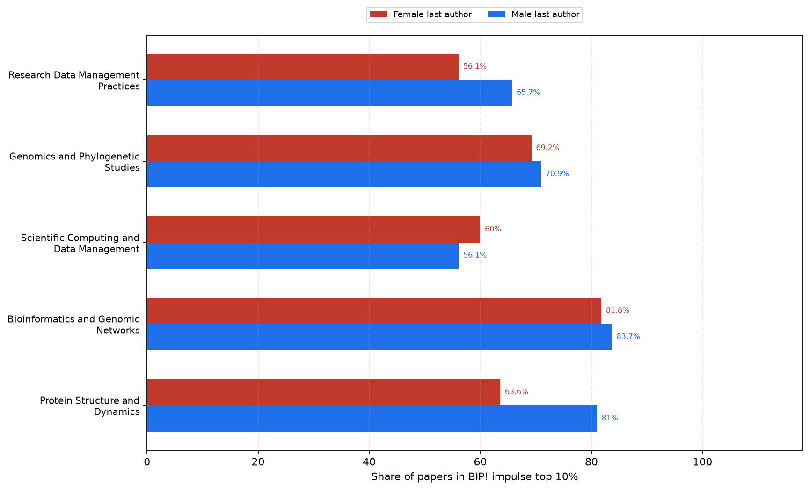
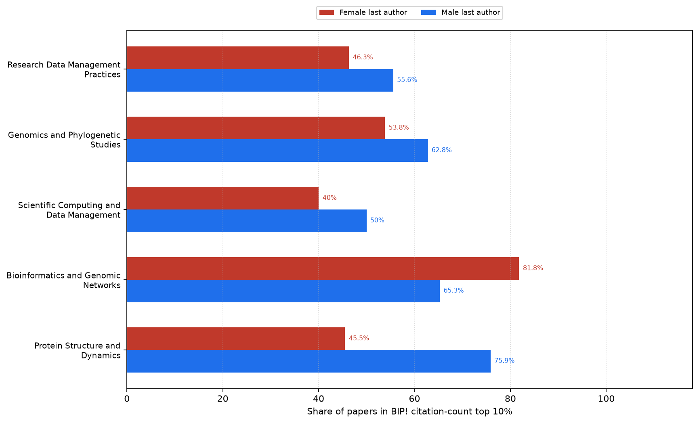

# ELIXIR topic BIP! by last-author gender

## Process

Last-author gender was attached from `data/elixir_unique_authors_dedup_countries_gender.tsv` to `data/elixir_works_metadata_openalex_bip.csv` (`scripts/attach_first_author_gender.py --role last`). Within each of the top 5 OpenAlex primary topics, we count papers by inferred last-author gender and recompute the same BIP! statistics as `count_topics.py` for female and male subsets.

### Join coverage (all papers)

- Papers: **1331**
- Male / female / unknown: **929** / **383** / **19**
- Match methods: `{'exact_full': 1265, 'unmatched': 13, 'norm_full': 51, 'no_author': 2}`

### Topics

| Topic | ELIXIR n | Female | Male | Unknown |
|---|---:|---:|---:|---:|
| Research Data Management Practices | 154 | 41 | 108 | 5 |
| Genomics and Phylogenetic Studies | 113 | 26 | 86 | 1 |
| Scientific Computing and Data Management | 95 | 26 | 66 | 3 |
| Bioinformatics and Genomic Networks | 73 | 22 | 49 | 2 |
| Protein Structure and Dynamics | 69 | 11 | 58 | 0 |

## Count and composition figures

Paper counts and percentage shares by last-author gender within each topic (unknown includes unmatched consortia and non-retrievable names).

### Paper counts by last-author gender

### Share of papers by last-author gender

## BIP! indicator figures

Grouped bars compare female vs male last-author subsets within each topic. The **bar length / x-axis** is the BIP! statistic; the label next to each bar repeats that value. Unknown-gender papers are excluded from these plots (subset sizes are in the topics table above).

### Median BIP! impulse (3-year citation count)

### Median BIP! citation count

### Share of papers in BIP! popularity top 10%

### Share of papers in BIP! influence top 10%

### Share of papers in BIP! impulse top 10%

### Share of papers in BIP! citation-count top 10%

## Per-topic gender BIP! stats

| Topic | Gender | n | median impulse | median cc | pct pop top10 | pct inf top10 | pct imp top10 | pct cc top10 |
|---|---|---:|---:|---:|---:|---:|---:|---:|
| Research Data Management Practices | female | 41 | 7 | 7 | 75.6 | 46.3 | 56.1 | 46.3 |
| Research Data Management Practices | male | 108 | 9.5 | 15 | 75.9 | 58.3 | 65.7 | 55.6 |
| Genomics and Phylogenetic Studies | female | 26 | 8.5 | 12.5 | 80.8 | 42.3 | 69.2 | 53.8 |
| Genomics and Phylogenetic Studies | male | 86 | 12 | 20 | 88.4 | 48.8 | 70.9 | 62.8 |
| Scientific Computing and Data Management | female | 26 | 5 | 7 | 64.0 | 40.0 | 60.0 | 40.0 |
| Scientific Computing and Data Management | male | 66 | 5.5 | 8.5 | 60.6 | 45.5 | 56.1 | 50.0 |
| Bioinformatics and Genomic Networks | female | 22 | 15 | 36.5 | 86.4 | 68.2 | 81.8 | 81.8 |
| Bioinformatics and Genomic Networks | male | 49 | 11 | 17 | 89.8 | 44.9 | 83.7 | 65.3 |
| Protein Structure and Dynamics | female | 11 | 7 | 7 | 81.8 | 36.4 | 63.6 | 45.5 |
| Protein Structure and Dynamics | male | 58 | 16 | 26.5 | 89.7 | 60.3 | 81.0 | 75.9 |

_Generated 2026-11-12 14:23 UTC_
